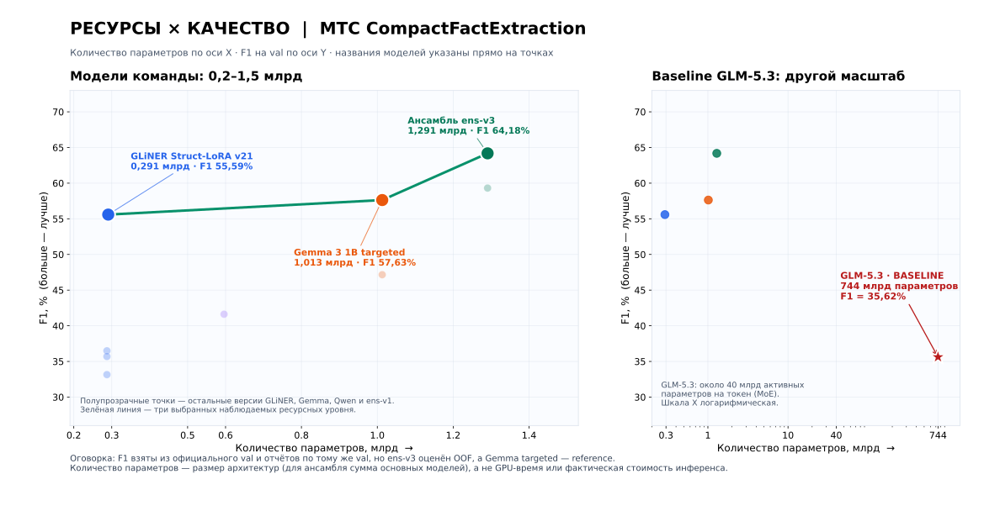

# Ресурсы × качество

CompactFactExtraction (МТС): три наших уровня — GLiNER, Gemma, ансамбль ens-v3 — против baseline GLM-5.3. Качество — официальный `case_metrics.py` v2.1 на val (383 звонка), ресурсы — единый замер `cfe/bench.py`.

## Итог

- Ансамбль ens-v3 (1,29 млрд параметров) даёт F1 **64,2%** (OOF) против 35,6% у baseline GLM-5.3 (744 млрд параметров, около 40 млрд активных на токен) и проходит планку организаторов по всем пяти метрикам.
- Он сильнее каждой из своих частей: GLiNER (0,29 млрд) — 55,6%, Gemma 3 1B — 57,6%. Выигрыш даёт сборка: precision ансамбля 0,758 против 0,64 и 0,57 у частей.
- Цена ансамбля на V100 (batch 16): около 2,7 GPU-секунды на звонок и 8,8 ГБ VRAM; на CPU один звонок занимает 33–90 секунд, пик RSS около 9 ГБ.
- Главные ошибки — пропуски `action` и `agreement` (recall 0,42 и 0,37) и даты у `service_state` и `tariff`. `ticket_status` решён почти полностью (recall 0,99).

## Кривая



По оси X — число параметров (для ансамбля сумма основных моделей), по оси Y — F1 на val. Параметры — размер архитектуры, а не стоимость инференса: стоимость в секундах и памяти — в разделе «Замеры ресурсов». Полупрозрачные точки на графике — остальные версии GLiNER, Gemma, Qwen и ens-v1. Оговорка с графика: F1 ансамбля оценён OOF, а у Gemma targeted — reference, поэтому точки сравнимы не полностью.

| модель | параметры, млрд | P | R | **F1** | temporal | state | grounding_turn |
|---|---|---|---|---|---|---|---|
| baseline GLM-5.3 (организаторы) | 744 (≈40 активных) | 0,3348 | 0,3805 | 0,3562 | 0,4706 | 0,5345 | 0,7835 |
| GLiNER Struct-LoRA v21 | 0,291 | 0,6414 | 0,4905 | 0,5559 | 0,3937 | 0,5185 | 0,7602 |
| Gemma 3 1B targeted (LoRA, слитая) | 1,0 | 0,5710 | 0,5816 | 0,5763 | 0,4477 | 0,5441 | 0,7866 |
| **ансамбль ens-v3, OOF** | 1,291 | 0,7579 | 0,5566 | **0,6418** | 0,4923 | 0,5714 | 0,7984 |
| ансамбль ens-v3, на val (реранкер обучен на этих же данных) | 1,291 | 0,7569 | 0,5637 | 0,6462 | 0,5023 | 0,6019 | 0,8038 |

OOF — несмещённая оценка (реранкер подбирался по фолдам). Строка «на val» оптимистична и нужна только как проверка, что рантайм воспроизводит результат.

## Замеры ресурсов

Методика (`cfe/bench.py`): прогрев на двух звонках не входит; GPU-секунды — время между `cuda.synchronize()` вокруг GLiNER и генерации Gemma, делённое на число звонков; загрузка моделей не входит; `peak_vram_gb` — `torch.cuda.max_memory_allocated`. Все замеры на 1× Tesla V100 32 ГБ (общий сервер, чужие процессы на GPU и CPU, так что секунды завышены) и Xeon E5-2698 v4. H100 в нашем распоряжении не было: образ для обычного GPU `cfe-gpu:1.0` запускался на V100 с бэкендом `hf`; его путь vLLM не исполнялся.

| конфигурация | выборка | GPU-с/звонок | в среднем на звонок, с | задержка p50 / p95, с | пик VRAM (torch), ГБ | пик RSS, ГБ |
|---|---|---|---|---|---|---|
| GLiNER, GPU, batch 16 | val, 383 | 1,0 | 1,1 | — | 6,7 | 3,2 |
| Gemma, GPU, batch 16 | val, 383 | 2,07 (230 токенов) | 2,07 | — | 6,3 | 3,0 |
| ансамбль, GPU, batch 16 | val, 383 | 2,65 (GLiNER 0,97 + Gemma 1,68) | 2,90 | — | 8,8 | 3,7 |
| ансамбль, GPU, batch 1 (`cfe-gpu:1.0`, hf) | 5 звонков | 14,6 (GLiNER 1,6 + Gemma 13,0) | 14,9 | 14,1 / 17,9 | 5,4 | 3,6 |
| ансамбль, CPU 16 ядер (`cfe-gpu:1.0`, `CFE_DEVICE=cpu`) | 5 звонков | — | 40,5 | 33,1 / 70,4 | — | 8,85 |
| ансамбль, CPU 8 ядер (`cfe-cpu:1.0-amd64`) | 40 звонков | — | 102 | 88,9 / 244 | — | 9,2 |

- Нарушений схемы во всех прогонах нет (после исправления `valid_to < valid_from`, см. ниже).
- Нагрузка сервера в этих прогонах была разной (четыре параллельных контейнера против одного), поэтому 40 с против 102 с не сравнивать как ускорение от числа ядер.
- Размер образов: `cfe-cpu` 14,2 ГБ (веса внутри, tar 6,0 ГБ), `cfe-gpu:1.0-v100` 57,6 ГБ, `cfe-gpu:1.0` 63,5 ГБ (в основном база vLLM). Веса: 2,05 ГБ на диске.
- vLLM на V100 проверен только как смоук: `/extract_batch` на 16 звонках — 16 ответов за 26,7 с вместе с прогревом. Полноценные замеры vLLM (batch 16 и 64), prompt 2048 и 1536, generation 512 и batch 1 с prompt-lookup не проводились: набор запусков готов в `bench_all.sh`, кривая по ним не построена.

## Устойчивость к шуму

Срезы val с добавленным ASR-шумом (`asr_noise --p P --seed 7`): `noise_level` 0,25 (выданные данные), 0,45, 0,65, 0,85. Ансамбль на CPU, первые 40 звонков val на каждом срезе (при ~100 с на звонок все 383 × 4 заняли бы около 40 часов), поэтому метрики шумные.

| срез | noise_level | P | R | F1 | temporal | state | grounding_turn |
|---|---|---|---|---|---|---|---|
| val | 0,25 | 0,745 | 0,580 | 0,652 | 0,500 | 0,642 | 0,792 |
| p20 | 0,45 | 0,757 | 0,527 | 0,621 | 0,478 | 0,508 | 0,762 |
| p40 | 0,65 | 0,746 | 0,469 | 0,576 | 0,509 | 0,508 | 0,691 |
| p60 | 0,85 | 0,771 | 0,406 | 0,532 | 0,633 | 0,508 | 0,702 |

Точность остаётся около 0,75–0,77 на всех срезах, падает полнота: с 0,58 до 0,41. F1 теряет 0,077 на p40 и 0,121 на p60. На `grounding_span` шум не меряется: он не пересчитывает gold-спаны.

## Разбор ошибок по типам фактов

Полный val, 383 звонка, 1845 gold-фактов. Тип факта — поле `attribute`. Пары предсказание–gold строятся функцией `match_facts` из `case_metrics.py`; общие числа расходятся с официальными метриками не более чем на 0,5 п.п. «Верные даты» — доля верных `valid_from`/`valid_to` среди совпавших фактов с восстановимой датой (для `action` не оценивается). Таблицы генерирует `cfe/error_report.py` по предсказаниям из `docs/data/`.

### GLiNER (383 звонков)

| тип факта | gold | предсказано | совпало | пропуски (FN) | лишние (FP) | precision | recall | верные даты | верная реплика |
|---|---|---|---|---|---|---|---|---|---|
| service_state | 453 | 324 | 183 | 270 | 141 | 0.565 | 0.404 | 0.184 | 0.820 |
| tariff | 146 | 215 | 116 | 30 | 99 | 0.539 | 0.794 | 0.150 | 0.707 |
| ticket_status | 400 | 409 | 365 | 35 | 44 | 0.892 | 0.912 | 0.389 | 0.822 |
| action | 368 | 190 | 109 | 259 | 81 | 0.574 | 0.296 | — | 0.908 |
| agreement | 478 | 273 | 132 | 346 | 141 | 0.483 | 0.276 | 0.807 | 0.432 |

Причины пропусков:

| тип факта | в звонке нет факта этого типа | есть факт этого типа в другой реплике | не то значение/объект в той же реплике |
|---|---|---|---|
| service_state | 82 | 96 | 92 |
| tariff | 19 | 4 | 7 |
| ticket_status | 1 | 9 | 25 |
| action | 152 | 61 | 46 |
| agreement | 218 | 112 | 16 |

Полярность: 1: gold 1824, recall 0.488, -1: gold 21, recall 0.667

### Gemma (383 звонков)

| тип факта | gold | предсказано | совпало | пропуски (FN) | лишние (FP) | precision | recall | верные даты | верная реплика |
|---|---|---|---|---|---|---|---|---|---|
| service_state | 453 | 376 | 229 | 224 | 147 | 0.609 | 0.505 | 0.244 | 0.860 |
| tariff | 146 | 128 | 89 | 57 | 39 | 0.695 | 0.610 | 0.262 | 0.809 |
| ticket_status | 400 | 389 | 366 | 34 | 23 | 0.941 | 0.915 | 0.466 | 0.904 |
| action | 368 | 303 | 149 | 219 | 154 | 0.492 | 0.405 | — | 0.946 |
| agreement | 478 | 686 | 236 | 242 | 450 | 0.344 | 0.494 | 0.719 | 0.432 |

Причины пропусков:

| тип факта | в звонке нет факта этого типа | есть факт этого типа в другой реплике | не то значение/объект в той же реплике |
|---|---|---|---|
| service_state | 68 | 98 | 58 |
| tariff | 44 | 9 | 4 |
| ticket_status | 11 | 12 | 11 |
| action | 84 | 94 | 41 |
| agreement | 16 | 138 | 88 |

Полярность: 1: gold 1824, recall 0.582, -1: gold 21, recall 0.333

### Ансамбль ens-v3 (383 звонков)

| тип факта | gold | предсказано | совпало | пропуски (FN) | лишние (FP) | precision | recall | верные даты | верная реплика |
|---|---|---|---|---|---|---|---|---|---|
| service_state | 453 | 255 | 200 | 253 | 55 | 0.784 | 0.442 | 0.326 | 0.850 |
| tariff | 146 | 194 | 118 | 28 | 76 | 0.608 | 0.808 | 0.253 | 0.771 |
| ticket_status | 400 | 430 | 397 | 3 | 33 | 0.923 | 0.993 | 0.495 | 0.899 |
| action | 368 | 215 | 154 | 214 | 61 | 0.716 | 0.418 | — | 0.955 |
| agreement | 478 | 280 | 177 | 301 | 103 | 0.632 | 0.370 | 0.867 | 0.412 |

Причины пропусков:

| тип факта | в звонке нет факта этого типа | есть факт этого типа в другой реплике | не то значение/объект в той же реплике |
|---|---|---|---|
| service_state | 106 | 92 | 55 |
| tariff | 22 | 2 | 4 |
| ticket_status | 1 | 1 | 1 |
| action | 123 | 64 | 27 |
| agreement | 141 | 121 | 39 |

Полярность: 1: gold 1824, recall 0.569, -1: gold 21, recall 0.429

### Выводы по типам

- **`ticket_status`** — решён: recall 0,99, precision 0,92, пропусков 3 из 400. Даты верны только в 0,50 случаев: цепочки статусов («принята → в работе → выезд») датируются хуже, чем определяются.
- **`tariff`** — высокий recall (0,81), но precision 0,61: 76 лишних фактов на 118 верных. Ансамбль берёт тариф там, где gold его не отмечает. Даты верны в 0,25 случаев; реплика-источник — в 0,77.
- **`service_state`** — самый крупный источник пропусков: 253 из 453. В 106 звонках факта этого типа нет вообще, в 92 он найден в другой реплике, в 55 — в нужной реплике, но с другим значением или объектом. Ансамбль повышает precision до 0,78 против 0,57–0,61 у частей, но платит recall (0,44 против 0,50 у Gemma). Даты верны только в 0,33 случаев.
- **`action`** — recall 0,42, пропусков 214 из 368; в 123 звонках факта этого типа нет вообще. Это единственный тип, где ансамбль почти не выигрывает у Gemma по полноте (0,42 против 0,41), но precision 0,72 против 0,49. Реплика-источник верна в 0,95 случаев, то есть ошибки — в определении самого действия, а не его места.
- **`agreement`** — хуже всего: recall 0,37, пропусков 301 из 478. Реплика-источник верна в 0,41 случаев (у Gemma и GLiNER то же 0,43). Договорённость обычно проговаривается в нескольких репликах, и gold привязывает её к другой, чем модель. Gemma даёт recall 0,49, но с 450 лишними фактами (precision 0,34): реранкер отрезает их, а с ними и часть верных.
- **Полярность −1** (21 факт, явное отрицание клиента): recall 0,43 у ансамбля, 0,67 у GLiNER, 0,33 у Gemma. Выборка мала.
- **Шум** (40 звонков, ансамбль на CPU, recall от val к p60): `service_state` 0,51 → 0,29, `tariff` 0,82 → 0,47, `ticket_status` 1,00 → 0,88, `action` 0,37 → 0,24, `agreement` 0,33 → 0,19. Меньше всего страдает `ticket_status` (шаблонные формулировки), больше всего — типы, зависящие от значения и формулировки.

Основные резервы по порядку: привязка `agreement` к нужной реплике, полнота `action` и `service_state`, даты у `service_state` и `tariff`.

## Проверка выходной схемы

`cfe/validate_schema.py` проверяет каждый факт (набор ключей, типы, `valid_to ≥ valid_from`, `speaker` реплики-источника, границы `span`) на всех звонках каждого прогона. На эталоне val — 0 нарушений. Первые CPU-прогоны нашли у части фактов `valid_to` раньше `valid_from` (6–10 на 40 звонков). В `cfe/runtime.py` добавлено `fix_intervals` (`valid_to := valid_from`); метрики кейса не меняются, образы пересобраны с исправлением.

## Что не вошло

- Прогоны остальных точек кривой (vLLM batch 16/64, ограничения prompt/generation, batch 1 с prompt-lookup) на трёх шумных срезах на GPU.
- Замеры на реальной H100.
- GLiNER-замер получен до правок `bench.py`, поэтому его `weights_disk` и память по `nvidia-smi` не приводятся.
- Полное переобучение не запускалось: воспроизводится цепочка (`repro.sh`), метрики val ожидаются в пределах ±0,01.

## Воспроизведение

```bash
python3 cfe/error_report.py data/raw/val.jsonl "Ансамбль ens-v3=docs/data/pred_ens_v3_val.jsonl"   # разбор ошибок
./bench_all.sh gpu | cpu                                                                         # замеры (нужны модели и GPU)
python3 cfe/curve.py --root runs/bench --out runs/bench/curve.md                                 # таблица кривой
```
